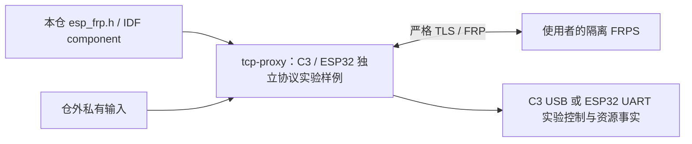

# 独立样例

样例只依赖本仓、固定 ESP-IDF 和公开组件，实验镜像不作为产品或 OTA 发布。先编译，再按实际目标和恢复基线单独授权、执行设备写入。

## 架构拓扑

[协议实验样例](tcp-proxy/README.md)默认 TCP，按显式 typed 输入装配 UDP、STCP/XTCP provider/visitor、HTTP/HTTPS 和 QUIC；HTTP/HTTPS 使用声明的外部测试后端。用于真实网络、生命周期与资源观测，无 GPIO 动作，也不读写 ESP Base 的身份或配置格式。编译与软件回环不等于设备或 Base 组合验收。
