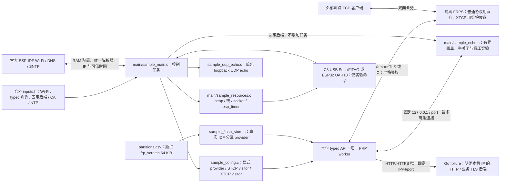

# 协议独立实验样例

此样例独立使用 `esp_frp.h`，固定 ESP-IDF v6.1 / ESP32-C3 或 ESP32-D0WD-V3（IDF target `esp32`）与 [sdk-lock.json](../../sdk-lock.json) 中的 lwIP 修正提交，带 `ESP_FRP_LAB_ONLY PROTOCOL_SAMPLE` 镜像标记。先按 [SDK 工具说明](../../tools/README.md) 准备独立 SDK；原始 SDK 的零窗口缺陷会被构建守卫拒绝。当前用于开发和实机资源验收，不能作为已验收产品固件。

## 架构拓扑



## 构建与输入

默认占位输入可以编译，运行时在初始化网络前停止。样例固定使用本目录 `partitions.csv`：factory app `0x10000..0x110000`、独占且未加密的 `frp_scratch` `0x110000..0x120000`。样例先逐项核对运行设备上的实际分区，再以独立样例 owner 调用真实 IDF 分区 provider 的 `recover`；任一步失败都在 Wi-Fi 前停止。通过显式路径注入本轮私有 header；它的字节会复制进 build 并编入镜像，输入、build、镜像和运行日志均须存放在受限目录，不提交真实资料：

```bash
source "$IDF_PATH/export.sh"
idf.py -C examples/tcp-proxy -B /private/path/frp-build \
  -D SDKCONFIG=/private/path/frp-sdkconfig \
  -D IDF_TARGET=esp32c3 \
  -D EFRP_NGTCP2_SOURCE_DIR=/path/to/locked-ngtcp2 \
  -D EFRP_PICOTLS_SOURCE_DIR=/path/to/locked-picotls \
  -D EFRP_SAMPLE_INPUTS=/private/path/inputs.h build
```

ESP32-D0WD-V3 使用独立的 build、sdkconfig 和相同私有输入格式，将 `IDF_TARGET` 改为 `esp32`。该 target 读取 `sdkconfig.defaults.esp32`，经 UART0 控制台收发实验命令，并以单核实验配置保证任务名快照不会与另一核的任务删除竞争；它只验证 ESP32 芯片上的本样例，不替代未来 Base 双核组合资源验收。C3 读取 `sdkconfig.defaults.esp32c3`，保留原 USB Serial/JTAG 路径。`dependencies.lock.esp32` 与原 C3 锁分离，构建后须核对最终 target、组件摘要及镜像身份，不得混用两套制品。

从 `inputs_example.h` 开始，填写自己的 Wi-Fi、NTP、唯一 FRPS 域名/端口、CA、Token 和身份。输入使用 `sample_configuration`：显式选择 `role`、`backend` 及对应的一个 typed 配置成员；旧 `sample_frp_config` 输入须直接重写，不保留双入口。默认是 TCP provider 与 loopback TCP echo。`remote_port=0` 让隔离 FRPS 分配端口，成功状态中的 `remote=` 用于本轮连接。这里不读取相邻 ESP Base、私有工作区配置或生产 FRPS catalog。

## 协议角色与固定后端

| 角色 / 类型 | 输入成员与 backend | 业务目标 |
| --- | --- | --- |
| TCP / STCP / XTCP provider | `.client.provider`，`SAMPLE_BACKEND_TCP_ECHO` | 唯一 `127.0.0.1:local_port`，沿用两个有界 TCP echo socket |
| UDP provider | `.client.provider`，`SAMPLE_BACKEND_UDP_ECHO` | 唯一 loopback UDP；显式 `udp_packet_size=1..1500` |
| HTTP / HTTPS provider | `.client.provider`，`SAMPLE_BACKEND_EXTERNAL` | 私有输入中唯一的非 loopback 单播 IPv4 / port，由隔离 Go fixture 提供实际 HTTP、业务授权及 HTTPS TLS |
| STCP visitor | `.client.stcp_visitor`，`SAMPLE_BACKEND_NONE` | 显式 `bind_ipv4:bind_port`；不创建 sample echo listener |
| XTCP visitor | `.client.xtcp_visitor`，`SAMPLE_BACKEND_NONE` | 显式 listener 与 inline `options`，业务仍须完成 peer 认证及双方证明 |

角色/backend 不匹配、UDP 超出样例容量、provider 的错误目标或 visitor 的通配 listener 在启动网络前拒绝。完整 CA、Token、typed 选项、secret、transport、注册与 XTCP 输入验证仍由正式公共 create API执行。样例不改写地址，不发现目标，不自动选协议或回退。FRPS 普通协议与原生 QUIC 使用官方 v0.71.0；XTCP 必须使用 [维护候选对端](../../peer/frp/candidate-development.md)。

provider 的 `proxy_type` 使用对应 `EFRP_PROXY_*`。STCP/XTCP 在 `.proxy_options` 中显式传入非空 `secret_key`；XTCP 还传入 `.xtcp_options`，包括固定 peer profile、至多两个数字 IPv4 STUN 端点及明确 UDP bind 地址/port。HTTP/HTTPS 在 `.proxy_options` 中声明域名/子域，后端 IP/port 必须与 fixture 的私有配置逐项相同；所有 FRP 业务仍经 ESP 的固定目标转发。HTTPS 业务 TLS 在 fixture 后端终止，这项实验不能授予 ESP 本机 HTTPS 服务或 Base 组合资源资格。

所有角色通过对应 typed 配置的 `.transport` 显式选择 `EFRP_TRANSPORT_YAMUX_TLS` 或 `EFRP_TRANSPORT_QUIC`。选择 QUIC 时同时指定 `.quic_profile=EFRP_QUIC_PROFILE_P256_AES128_X25519` 和 FRPS 实际 QUIC 端口；不在 QUIC 中叠加 Yamux。provider 的 `user` 与完整 wire `proxy_name`、visitor 的 `user` 与 `server_proxy_name`，必须与 fixture 登录和目标身份一致，不用拼接或猜测替代声明。

STCP visitor 可把示例中的 `sample_configuration` 定义整体替换为下面的占位输入；设备 IPv4 必须换成本轮真实站点地址，fixture 只访问这个明确地址，不由样例绑定通配 listener：

```c
static const sample_configuration_t sample_configuration = {
    .role = SAMPLE_ROLE_STCP_VISITOR, .backend = SAMPLE_BACKEND_NONE,
    .client.stcp_visitor = {
        .server_hostname = "frp.example.invalid", .server_port = 7000,
        .transport = EFRP_TRANSPORT_YAMUX_TLS,
        .ca_pem = sample_ca_pem, .ca_length = sizeof sample_ca_pem - 1,
        .token = sample_token, .token_length = sizeof sample_token - 1,
        .user = "lab", .client_id = "explicit-device-client",
        .server_proxy_name = "lab.private", .secret_key = "replace-with-private-secret",
        .bind_ipv4 = {192, 0, 2, 10}, .bind_port = 8766,
    },
};
```

XTCP visitor 改用 `SAMPLE_ROLE_XTCP_VISITOR` 和 `.client.xtcp_visitor`，保留同样的登录/监听字段，并在该 typed 成员的 `.options` 直接填写上述 XTCP 选项。可信时间与真实 Flash provider 始终由样例注入；输入可明确给定 `run_id`，完成鉴权后才保存并在 `cycle` 中重用服务端接受的身份。

UDP echo 只保留一个完整包与来源，最多 1500 B，加一个字节检测超限；超限整包丢弃，空包保留，发送背压时不接收下一包。stop/destroy 成功后清除待回包；取消及后端关闭失败不遗弃 fd。此容量仅是实验后端边界，正式组件的 typed UDP 上限仍为 65507 B。

扩展设备测试使用 [Go 单设备协议互测入口](../../tests/crypto-interop/README.md)。其私有配置显式声明本机与设备 IPv4、FRPS/后端/visitor 端口、身份、证书与实际协议；它不刷写、不发现设备或修改 sample 输入。只有外部驱动核对真实设备 READY 后才发送精确 `resume`，服务端业务结果须与串口 `EFRP_SAMPLE_PROTOCOL` 的角色、transport、XTCP 阶段、UDP 计数及资源样本联合核验。软件回环中的同入口结果仅验证实验接线。

`sample_dns_ipv4` 为空时使用 DHCP 提供的正常 DNS；填入明确 IPv4 时，每次获得 IP 后将其设置为唯一主 DNS，并清空备用位置，适合本机隔离 DNS fixture。SDK 的 `esp_netif_set_dns_info` 拒绝零地址，因此备用位置通过 `tcpip_callback_wait` 在 lwIP 线程清空，完成后才启动 SNTP。证书身份仍是 `server_hostname`，不能用绕过身份校验替代 DNS。NTP 应是可信且可达的时间来源；收到实际同步后才启动 FRP，超过两小时未再次同步则可信条件失效。

默认两目标均按 4 MiB 和上述样例专用分区构建，并不等于某块既有设备的可刷布局。运行时的 `frp_scratch` label/type/subtype/offset/size/erase_size/只读/加密属性与本样例合同不一致即拒绝启动；只刷 app 而设备没有该分区时不会运行。给已有板测试时，必须先在仓外确认分区表、应用槽和完整恢复基线；样例不导入其他仓的分区文件。编译不执行 flash。必须重新枚举、验证芯片/Flash/UUID 和活动分区，保存两份一致的完整基线，再单独决定分区表及应用槽变更。测试后恢复完整基线并核对非应用分区及身份；禁止照抄 build 输出里的全盘写入命令。

Wi-Fi 使用 `nvs_enable=false` 和 RAM storage，PHY 校准持久化必须关闭；样例不初始化、擦除、读写 NVS，不驱动 GPIO。`recover` 与大于 4096 字节的控制记录只访问专用 `frp_scratch`，小控制记录走 RAM。已有身份和配置不是本例的运行依赖，也不是通过串口端点猜出的身份。

## 实验操作

所选控制台（C3 USB Serial/JTAG、ESP32 UART0）输入为一行一个精确命令，最多 63 个 ASCII 字符；超长或非法行整行拒绝。它不是产品设备控制协议，无 UUID/业务 ACK 或远程写权限含义。主机须独占端点并持续读取输出：

- `stats`：状态、回显计数、任务栈、socket 和 esp_timer。
- `restart`：同一实例 stop/start；`stop`、`start` 单独控制。
- `stop_poll`、`stop_short`：分别以零等待和 50 ms 调用 stop；迟到 DNS 尚未收敛时，应分别返回 WOULD_BLOCK / TIMEOUT，并保留句柄与停止请求。之后仍须等 `stop` 成功。
- `destroy_short`、`destroy`：分别以 50 ms / 30 秒调用 destroy；只有成功才释放并清空句柄，报告销毁后资源，不自动新建。使用 `start` 可重新创建。
- `cycle`：保存已验证 run_id，完整 destroy，报告销毁后资源，再 create/start 并重新鉴权；统计 cycle 必须逐次确认，不能把命令写入当作成功。
- `wifi_down`、`wifi_up`：停止/启动本板 station，让已有 FRP worker 处理网络中断与恢复；不代表外部 AP 或人工断电验收。
- `echo_off`、`echo_on`：取消/恢复所选 loopback TCP 或 UDP listener，用于本地拒绝与连接中断；external 后端和 visitor 返回 INVALID_STATE。`echo_off` 在 fd 尚未释放时返回 WOULD_BLOCK，由 main 继续收敛；仅返回 OK 才表示本例后端已关闭。
- `echo_local_fin`：仅在没有活动连接和待用实验模式时，为下一条连接准备半关闭实验。先增量发送 300001 字节固定模式并关闭写方向，再逐字节校验对端随后发送的 300001 字节，最后报告 `EFRP_SAMPLE_ECHO_PROOF`；完整长度、零 mismatch、双方 EOF 和未取消共同决定 `valid=1`。
- `echo_stall`：同样只影响下一条连接，暂停其读取；第二条连接仍正常回显。`echo_resume` 只恢复唯一暂停连接，供故障结束后的目标 socket 清理使用。
- `echo_reset`：仅有一条活动本地连接时，请求零 linger 关闭该连接；仅在 fd 已关闭时返回成功，关闭失败保留 fd，由主循环继续清理。`work-shared` 实验须先用 `echo_stall` 暂停该连接并等待 `pending_read=1`，再核对命令成功、远端 RST 与 work 失败状态；命令回执本身不是 RST 证明。

以下半关闭、暂停、resume 与 reset 命令只适用于 TCP echo，其他后端明确返回 INVALID_STATE。TCP 回显服务只有两个 1024 字节缓冲，由 main 推进；半关闭模式也用原缓冲增量生成/校验，不分配完整载荷。实验模式仅消费一次，`echo_off` 清除未使用的模式。它只在板内回环监听，不提供未鉴权的局域网实验控制入口。首个 FRP READY 需完成严格 TLS、注册与认证 Pong；业务字节仍应由外部测试客户端逐字节或摘要核对。

启动或 DNS/SNTP 重配失败时，main 保留真实句柄并推进客户端及后端的取消，直到 native fd 和 worker 真正释放再退出，不把异常出口返回当作清理成功。

状态包含 `failure_phase`、`system_error` 和单调 `time_ms`，用于区分 DNS/TCP、TLS 与协议失败；工作流的 `requests`、`rejected`、`pending`、`cleaning` 分别记录请求/拒绝累计数和待处理/清理中数量，可与 `active`、`waiting`、`failed`、`work_error` 一同验证异常隔离和有界容量。命令回执记录实际返回值、耗时与句柄是否仍存在；短期限返回不能当作清理完成。

## 资源与边界

状态采样报告当前 AP 的 `rssi_dbm`；仅 `rssi_valid=1` 时有效，断线时不能把占位零值当信号强度。资源采样包含 heap、全程最低 heap、最大连续块、所有当前任务的栈余量、有界描述符扫描、SDK 分配失败次数/最后失败尺寸和 esp_timer 列表。分配失败回调只写原子计数，不在分配路径打印或申请内存。样例只在单核调度配置下暂停调度并复制任务名，避免跨采样借用 TCB；超过 32 个任务时数量为零，表示采样不完整。每次采样还使用 SDK 的 64 位 ESP timer运行计数，输出 `EFRP_SAMPLE_RUNTIME` 的 `total_runtime_us`、`capture_start_us`、`capture_end_us`、`expected_tasks` 和 `complete`，以及每个任务的 `task_number`、`runtime_us`。只有同一暂停窗口返回非空且数量与实际任务数相等时 `complete=1`；读取间隔和稳定 task_number可用于分析原始计数，删除任务与当前未闭合调度 slice 的时间不归属于当前列表，不能直接宣称 CPU 百分比或长稳资格。采样、串口打印和计数本身的成本计入候选实测；main 的 4 KiB 栈须靠实体高水位验证，host 对象尺寸不能替代。socket 扫描可能与 SDK 开关连接并发，需分别比较稳定在线和销毁后样本；它不是原子网络快照。esp_timer profiling 也不是全部 FreeRTOS/lwIP 计时资源枚举。

样例将 Wi-Fi 静态 RX 数量设为 6（与 RX BA 窗口相同），动态 RX/TX 各 12，TCP 收发窗口各 2880 字节（两个默认 MSS）。这是为 C3 双流约束瞬态队列占用的装配配置，会限制吞吐；不改变 FRP、Yamux 或 AEAD 的协议容量，也不要求使用该库的其他应用照搬。

本样例只使用 station，因此关闭未消费的 SoftAP 支持。断言保持检查与 abort，仅关闭断言文本；排障使用对应 ELF 和回溯。IPv6 保留，因为固定 ngtcp2 的 POSIX 地址合同包含 IPv6 结构。2026-10-03 同一非空公共输入的冻结源码复测中，原完整镜像 C3 `0x118b30`、ESP32 `0x104d40` 超过上述 1 MiB app 分区；关闭 SoftAP 与断言文本后分别为 `0x0f7740`、`0x0e7880`，原分区未变。这批源码尚未包含随后接入的完整 XTCP 控制器与证书生成，不能作为当前候选或 Base 原生业务组合的容量验收。

同日当前完整 XTCP 源码复测先得到 C3 `0x102320`（超原槽 8992 B）、ESP32 `0xf1460`。C3 专属默认配置随后仅开启 SDK 官方 `CONFIG_COMPILER_SAVE_RESTORE_LIBCALLS=y`：有效配置唯一差异是寄存器保存/恢复使用调用，镜像减 24512 B 至 `0xfc360`，原 1 MiB 槽余 15520 B；ESP32 原配置余 60320 B。正式 QUIC/XTCP、NAT、双方证明、身份生成、严格证书/CV 与普通 TCP/Yamux 的 59 个必要符号都真实链接，RISC-V helper 实际位于 IRAM。该优化有轻微性能代价；没有启用 LTO、扩大分区或删除认证。精确公共编译输入、最终源码/制品摘要及原失败见[软件检查点](../../docs/verification/xtcp-candidate-software-20261003.md)。该历史构建采用 TCP 配置，编译和符号保留只证明对应冻结输入的组件装配与独立样例静态容量；当前扩展装配还须以本轮实际镜像与配置重新核对容量，扩展实际握手、运行 heap/栈与原生业务、MQTT、固件 OTA 组合另测。

串口输出和诊断本身消耗资源，实验配置使用 4 KiB main 栈，FRP worker 使用 6 KiB；两者根据 C3 高水位采样从较大的初始预算收敛。当前 6 KiB worker 的同板十轮双流压力采样中，最低栈余量为 3104 字节；ESP32 的栈、heap 和双流资源必须另测，不能沿用 C3 数值。完整样例包含 Wi-Fi、TLS、AEAD、四条 Yamux 流、两条 work socket 及回环对端，不能仅以静态对象大小或 host 数据推断内存安全。

真实验收须覆盖 DNS/TLS/FRPS、双流大载荷和背压、拒绝/错误认证、服务重启、百次完整客户端释放及资源峰值。维护者已于 2026-09-24 确认具备人工断电拔插测试条件，后续按[Base 原生业务与固件 OTA 计划](https://github.com/darren-you/esp-base/blob/master/docs/operations/ota-allocation-diagnostic-checkpoint.md)当前决定和对应实板前置执行；设备、分区与完整 Flash 恢复基线仍须逐轮核对，未执行项保持未验收。软重启、station 停启或软件注入不能替代断电。
