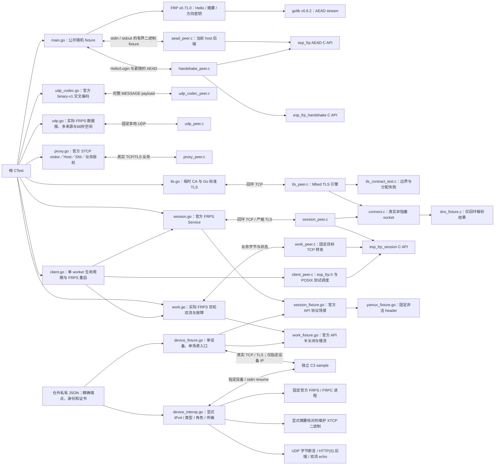

# FRP 控制会话与工作流互操作

## 架构拓扑



Go >=1.25，`go.mod` 与 `go.sum` 固定官方 FRP 及公开传递依赖。模块调用原始上游 API，不复制派生算法，不用相邻 checkout 的 replace。首次运行需要下载模块；host 测试的 Token 与随机 Hello 只用于进程内测试，TLS 模式另外创建回环监听。单设备入口仅消费显式私有实验配置，不读取生产配置。

从仓根启用 `-DEFRP_TEST_UPSTREAM_CRYPTO=ON` 后运行 CTest。单独调试可在本目录执行 `go run -mod=readonly . -peer /absolute/path/to/aead_peer`；peer 来自仓根 CMake 构建。CTest 总期限 120 秒，每个 C 子进程期限 10 秒。

12 组双向载荷包含 0、1、15、16、17、511、512、513、65535、65536、65537、300001 字节；官方 server 写入的记录交给唯一 Flash reader 的 C client，C 回写后由官方 server 解密并逐字节比较，另直接比较原始 Hello 摘要。10 组拒绝覆盖 nonce/密文/tag、Token、客户端/服务端原文空白变化、尾部截断、方向反射和记录乱序。此处测试密码记录，不等同于 FRP 登录、Yamux/TLS 组合或实板验收。

同一选项还运行 `handshake_upstream`：官方解码 C 的 Login 并执行 TokenAuth.VerifyLogin，发送 Hello/LoginResp 与紧随的加密 Pong，再解码 C 的加密回写。9 组正例和 6 组拒绝用例见[握手合同](../../docs/design/control-handshake.md)。单独执行为 `go run -mod=readonly . -handshake-peer /absolute/path/to/handshake_peer`。这里只执行上游协议 API，没有启动完整 FRPS 或 TLS listener。

完整 Mbed TLS host 构建增加 `tls_upstream`，单独执行为 `go run -mod=readonly . -tls-peer /absolute/path/to/tls_peer`。先运行配置/取消/回调边界，再由 Go 标准 TLS 服务端与 C 引擎建立 113 条真实连接：100 次 TLS 1.3、TLS 1.2、强制分片、四类证书拒绝和七种终止场景。TLS 服务端不包含 FRP 会话；覆盖和限制见 [TLS 合同](../../docs/design/tls-transport.md)。

C peer 经当前 `connect.c` 建连及收发，终止时检查 fd 已释放。测试 DNS 只返回回环地址，不执行真实域名查询；其与 SDK 回调收敛的区别见 [连接生命周期](../../docs/design/connection-lifecycle.md)。

`session_upstream` 首次实际启动固定版本的 FRPS `server.NewService`，关闭 Dashboard，transport 与 proxy listener 明确绑定回环；使用临时 CA、证书和公开 fixture Token，启用 HeartBeats/NewWorkConns scopes。100 次注册/销毁、真实请求触发 ReqWorkConn、两个连续心跳、37/41 字节与 WOULD_BLOCK、Token/端口拒绝及两种取消逐项验证；官方返回 `:端口`，测试用已固定的 loopback 补齐连接地址。结束后确认代理监听撤销。

随后 `session_fixture.go` 构造 29 个组合边界场景，覆盖尾数据、4096 字节 payload、单条 64 KiB AEAD 明文及错 tag、clear 失败时 session handle 保留和重试、超长控制帧/AEAD 记录、异常控制消息、截断、篡改、FIN 和期限。八个 Yamux 场景在真实 TLS 后直接发送固定非法 header，检查版本、类型、旗标、信用、窗口溢出、未打开流、RST 与截断，不另实现服务端复用协议。单独执行为 `go run -mod=readonly . -session-peer /absolute/path/to/session_peer`。这证明 host 上的控制会话，不是 C3 资源或实板通过，详见 [控制会话](../../docs/design/control-session.md)。

`go run -mod=readonly . -work-peer /absolute/path/to/work_peer` 通过实际 FRPS 完成百轮双流，每流两个方向各 300001 字节，另有应用回执防止服务端 EOF 全关闭语义截断测试载荷。添加 `-work-faults` 则执行四个真实 FRPS 故障用例及 13 个官方 API fixture；覆盖精确目标绑定、容量、半关闭、尾数据、错误字段、期限和慢流恢复。核心只消费已有固定依赖，无自写服务端密码算法；完整边界见 [工作流](../../docs/design/work-streams.md)。

`work_peer` 的独立工作流分配钩子验证 4096 字节握手区至多同时存在一份，并在实际 FRPS 与故障场景结束后全部清零释放；这不代替 MCU allocator 峰值采样。

`client.go` 使用同一真实 FRPS 构造器，运行应用层 `esp_frp.h` 生命周期。`session.go` 允许测试显式停止并重新创建同一端口的 FRPS；`restart-active` 在两条活动流各交付一字节后停服，核对旧连接清理、同一 worker 重新注册和两条新流的完整双向字节，不用空闲 READY 代替活动中断恢复。`work.go` 另以 worker 运行三轮双流，随后保留两条本地连接验证停止清理。配置、信任、回调和调度边界见[客户端生命周期](../../docs/design/client-lifecycle.md)。

## 单设备协议 fixture

`go run -mod=readonly . -device-config /private/path/device-fixture.json` 复用上述场景，单次只接收一个明确 IP 的对端。配置必须是至多 16 KiB、无组/其他用户权限的普通 JSON 文件，拒绝未知字段；以下均为文档占位值：

```json
{
  "listen_ipv4": "192.0.2.10",
  "listen_port": 17400,
  "allowed_peer_ipv4": "192.0.2.20",
  "certificate_file": "/private/path/server.pem",
  "private_key_file": "/private/path/server.key",
  "mode": "fixture-aead-max",
  "token": "replace-with-isolated-fixture-token",
  "client_id": "isolated-c3",
  "proxy_name": "isolated-tcp",
  "timeout_ms": 25000
}
```

端口限定 1024–65535，期限为 1000–90000 ms；证书/私钥使用绝对路径。客户端必须按真实主机名和 CA 校验服务端，fixture 精确验证 Login 的 `client_id`、Token 和 NewProxy 的名称/类型/配置。IP 限定仅收窄实验对象，不能代替协议认证。

`mode` 支持 `sessionFixtureModes` 的 28 项，以及 `work-wrong-name`、`work-error`、`work-oversized`、`work-truncated`、`work-bad-port`、`work-duplicate`、`work-frame-timeout`、`work-idle`、`work-tail-fin`、`work-local-fin`、`work-spare`、`work-stall`、`work-shared`。`work-idle` 使用真实 60 秒空闲期限，fixture 应配置 90000 ms；工作流场景保留控制通道并响应认证心跳。

host 和 device 使用相同工作协议；前者的本地目标变换测试字节，后者按独立 C3 / ESP32 样例回显原字节。`work-tail-fin` 将 StartWorkConn 与首段业务粘连，此后每次写入至多 1 KiB 业务字节并读取等量回显，末段写入后发送 FIN；`work-local-fin` 先收齐本地载荷和 FIN，再按至多 1 KiB 分块发送反向载荷及 FIN。两种交换均避免测试端点以单次 300001 字节 Yamux 写入填满小窗口并互相等待。半关闭的每个方向各 300001 字节，不能只用 EOF 证明完整交付。

- `work-tail-fin`：StartWorkConn 紧随业务，远端先 FIN，核对返回数据。
- `work-local-fin`：启动前向样例发送 `echo_local_fin`；先核对本地数据与 FIN，随后才发送反向载荷，并与样例的完整逐字节证明联合验收。
- `work-spare`：打印 `phase=waiting-spare` 后等待标准输入的一行精确 `resume`；控制心跳继续。实板驱动应观察超过 60 秒的等待和没有本地 socket，再恢复握手与传输，使用 90000 ms 总期限。
- `work-shared`：启动 fixture 前先对空闲样例执行 `echo_stall`，使第一条本地连接保持暂停读取。fixture 给第一条流发送 1024 字节后打印 `phase=partial-handshake` 并等待 `resume`；驱动先验证一条 active、一条 waiting，再执行 `echo_reset`，只在命令成功且日志显示 `paused=1 pending_read=1` 后恢复。最后确认旧流 RST、第二条流完整双向字节及资源回收。若尚无待读字节，稍后重试 `echo_reset`，不能把命令已写入当成 RST 已发生。
- `work-stall`：启动前执行 `echo_stall`，向第一条流写入足以产生背压的数据，第二条流独立核对 64 字节回显；观察慢流结束后执行 `echo_resume`，回收样例目标端的 fd。

恢复输入最多 64 字节，非法行、EOF、信号或总期限终止场景；等待恢复不绕过 fixture 的连接期限。输入动作本身不访问设备，刷机和样例命令仍由外部驱动执行。

入口没有设备发现、刷机、DNS 服务、代理监听或生产安装操作。`ESP_FRP_DEVICE_FIXTURE_READY` 只说明监听建立，`ESP_FRP_DEVICE_WORK_FINISHED` 说明工作场景按其断言结束，`ESP_FRP_DEVICE_FIXTURE_FINISHED` 说明服务端场景结束；三者都不能单独作为实板通过。验收还须核对设备的精确错误、状态/资源回收，以及恢复到官方 FRPS 后的业务字节。私有配置、证书、输入和日志不得提交。

## 扩展入口

`-udp-codec-peer` 交叉检查官方 binary-v1 codec；`-udp-peer` 运行完整 FRPS 的固定目标 UDP，包括 66 秒真实空闲；`-udp-client-peer` 单独验证同一 worker 活动中断后重连与资源回收；`-proxy-peer` 使用完整 FRPS、官方 STCP visitor、HTTP Host 和 HTTPS SNI 检查类型化 provider。均使用本仓构建的绝对 peer 路径，只监听回环；完整命令、时限与验证边界见[测试说明](../README.md#协议扩展软件测试)。这些 host 入口不属于前述异常协议单设备模式。

## 实体设备扩展互操作入口

从本目录执行 `go run -mod=readonly . -device-interop-config /private/path/device-interop.json`。入口启动本次隔离 FRPS、所需 FRPC 与业务后端，只接收配置声明的设备 IPv4、Login `client_id`／`user` 和精确类型化代理；不存在设备发现、串口控制、刷写、生产服务修改或协议回退。普通代理固定构建本模块锁定的原样官方 FRP v0.71.0 `frps`／`frpc`，新增命令行消费者的传递依赖同样固定在 `go.mod`／`go.sum`。

配置要求与异常协议入口相同：0600 普通文件、最多 16 KiB；字段必须为精确 snake_case，重复或未知字段拒绝，单次只声明一个角色、类型与传输。`listen_ipv4`／`device_ipv4` 必须为显式单播 IPv4，禁止主机名与通配地址。端口限定 1024–65535，期限为 1000–300000 ms，并包含构建、装配、等待和业务传输。`evidence_directory` 必须是可新建的绝对路径，已有目录拒绝覆盖；目录以 0700 创建，保存 0600 原输入、FRP 配置、原进程日志与 `result.json`。以下为 UDP provider 占位输入：

```json
{
  "listen_ipv4": "192.0.2.10",
  "listen_port": 17400,
  "device_ipv4": "192.0.2.20",
  "transport": "tcp",
  "role": "provider",
  "proxy_type": "udp",
  "proxy_name": "isolated.udp",
  "user": "isolated",
  "client_id": "isolated-device",
  "token": "replace-with-isolated-fixture-token",
  "remote_port": 17401,
  "certificate_file": "/private/path/frps.pem",
  "private_key_file": "/private/path/frps.key",
  "ca_file": "/private/path/frps-ca.pem",
  "server_name": "frp.fixture.invalid",
  "timeout_ms": 90000,
  "evidence_directory": "/private/path/new-device-udp-run"
}
```

设备输入必须独立装配同一服务器地址、端口、严格 CA／主机名、Token、身份与类型化代理。`proxy_name` 是完整 wire 名：`user` 非空时必须包含 `<user>.` 前缀；官方 FRPC 的本地配置名称由入口按这个明确前缀装配。端点允许列表仅限制实验对象，FRPS 仍执行正式 Token 与附加 HeartBeats／NewWorkConns scopes 验证。

| 实验角色／类型 | 必填类型字段与业务范围 |
| --- | --- |
| provider TCP／UDP | `remote_port`；设备的固定本地目标分别使用 TCP echo／UDP echo。UDP 核对两个来源各自 0、1、127、1024、1500 字节完整数据报。 |
| provider STCP | `secret_key`，最多 128 UTF-8 字节；官方 FRPC visitor 拨精确 provider，设备 wire 的 `allow_users` 必须为空，由 FRPS 按 provider user 默认化。 |
| visitor STCP | `secret_key`、设备 `visitor_port`；官方 FRPC provider 仅允许该 `user`，业务直接拨指定设备 IPv4 的 listener。 |
| provider HTTP／HTTPS | `custom_domains`、`vhost_port`、`backend_port`、`backend_token`；1–4 个合法 ASCII 域名，最多 253 字节，按大小写折叠拒绝重复。设备固定 `local_ipv4`／`local_port` 必须是本次 `listen_ipv4`／`backend_port`，采用 external backend。 |
| provider／visitor XTCP | 对应 STCP 角色字段，加 `frps_binary`／`frpc_binary`、`frps_sha256`／`frpc_sha256`、两项 `stun_ports`；只消费维护候选。 |

STCP／XTCP／TCP 的成功业务断言是两条并发 echo 流，每条按最多 1024 字节写入后读取等量回显，共 300001 字节，然后发送 FIN 并核对回端 EOF 和空尾部。它不依赖 host C peer 的载荷变换协议。

HTTP／HTTPS 后端绑定本次明确的宿主 IPv4，处理 `GET /body?id=<uint32>`；要求 `Authorization: Bearer <backend_token>`，每个注册域名返回精确 300001 字节测试图案。缺少 Bearer 必须返回 401，且业务授权计数不增加；未注册 Host／SNI 不能得到业务响应，原始后端 accept 和 HTTP 请求计数均不得增加，不能以后端 400 或 TLS 拒绝冒充路由未抵达。HTTPS 还要求绝对 `backend_certificate_file`、`backend_private_key_file`、`backend_ca_file`：证书 SAN 覆盖所有域名，业务 TLS 与 FRPS 控制 TLS 是两个独立信任输入，客户端正常验证 CA／主机名。backend 检查真实 SNI 与 Host 一致。非 HTTP 类型拒绝所有 HTTP 业务字段；非 HTTPS 类型拒绝业务 TLS 文件；provider 拒绝 `visitor_port`，非 TCP／UDP 拒绝 `remote_port`，非私有类型拒绝 `secret_key`。

`transport` 必须显式为 `tcp` 或 `quic`。QUIC 额外要求 `quic_port`，设备和本次官方 FRPC 都使用该原生 QUIC 入口；TCP 禁止同时声明 QUIC 端口。类型、角色与传输不会因失败自动改变。

XTCP 输入二进制必须是本仓 `peer/frp` 当前精确维护源码构建的产物。先从明确的维护 checkout 按 [候选说明](../../peer/frp/candidate-development.md)执行 `go build -mod=readonly -tags=noweb -o /private/path/peer-bin/ ./cmd/frps ./cmd/frpc`，再将两个实际产物的 SHA256 填入私有 JSON；入口不搜索或下载维护产物，不替换本模块的官方依赖。执行前检查绝对路径、普通可执行文件、非 symlink 和精确摘要，并将核对的原字节复制到本次私有目录后执行。`stun_ports` 对应 `listen_ipv4` 上的两个本地标准 STUN binding responder；设备的两个固定 STUN 端点必须同它们一致。此入口只验证 LAN 会合与业务，不模拟或授予异网 NAT、穿透成功率或绕过 FRPS 的网络验收。

`ESP_FRP_DEVICE_INTEROP_READY` 只表示对端软件装配完成。外部驱动需独立观察设备完成鉴权及 READY，核对设备身份、资源与角色，再向标准输入发送一行精确 `resume`。EOF、非法行、信号和原期限都会终止并清理。所有对端进程、后端 listener、活连接与协程结束后才写成功结果和 `ESP_FRP_DEVICE_INTEROP_FINISHED`；失败／取消仍保留私有原件。结果记录原配置摘要、实际 FRPS／FRPC 二进制摘要及本次确切业务范围。成功结果只证明该切片的业务，设备自身状态、Flash lease、fd／heap 回收和恢复必须由外部实板驱动另行核对；不表示实板完整矩阵通过。

新增入口的定向软件检查使用 Go FRPC 代替设备，覆盖普通协议角色装配、显式 QUIC、输入／身份拒绝和 HTTPS 活连接取消：

```sh
go test -mod=readonly -race -count=1 -run '^(TestDeviceInterop|TestDeviceResumeInput)' ./...
```

这里的 `-race` 只覆盖新增 Go fixture 进程；实际 FRPS／FRPC 是固定源码构建的独立 CLI 进程，未以 race detector 构建，不能由此授予对端内部 race 资格。首轮以进程内官方 `client.Service` 代设备时，固定 v0.71.0 的 `Service.stop` 与 `keepControllerWorking` 在断连退出期间产生数据竞争；当前测试按实体入口的真实 CLI 进程边界装配，不修改上游源码。该首轮失败不能记作通过。

维护 XTCP 的两角色装配检查必须显式提供上述维护构建产物：

```sh
EFRP_DEVICE_MAINTAINED_FRPS=/private/path/peer-bin/frps \
EFRP_DEVICE_MAINTAINED_FRPC=/private/path/peer-bin/frpc \
go test -mod=readonly -race -count=1 -run '^TestDeviceInteropMaintainedDrivers$' ./...
```

未提供这两个输入时测试明确跳过，跳过不计为 XTCP 通过。上述检查仅验证新增 fixture 自身，不重新运行原 C 协议矩阵，也不访问任何设备。私有运行目录、原输入、证书、日志和结果均不得提交。
